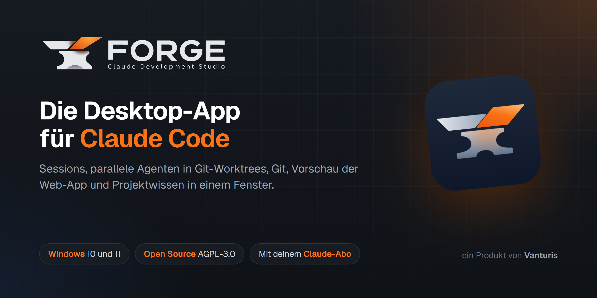
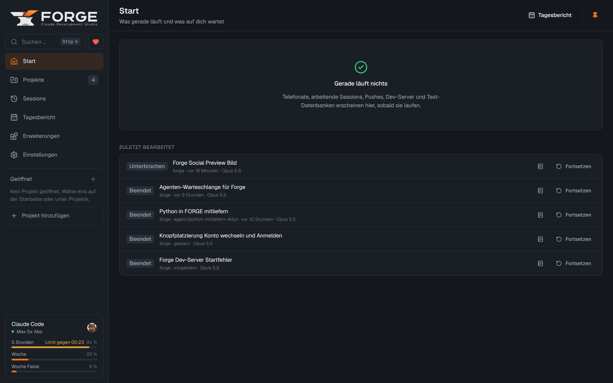
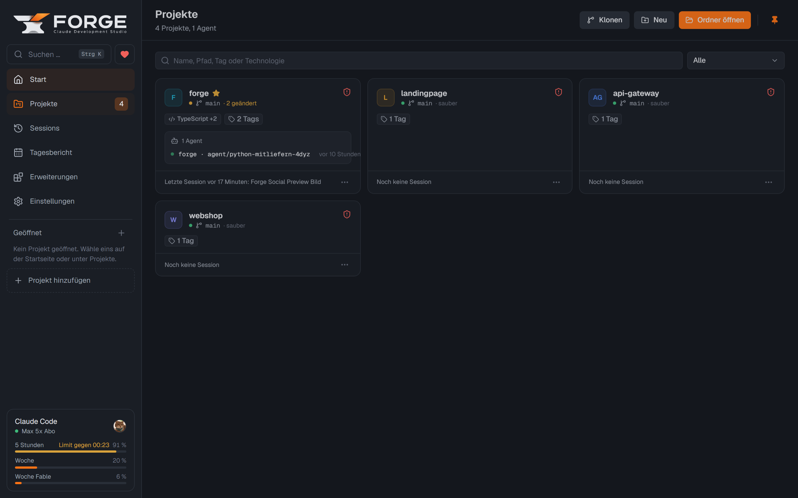

<a href="README.md"> English</a> ·  Deutsch

<p align="center">
  
</p>

<p align="center">
  <a href="https://github.com/vanturis/forge/releases/latest"></a>
  <a href="https://github.com/vanturis/forge/releases/latest"></a>
  <a href="LICENSE.md"></a>
  
  <a href="https://forge.vanturis.de"></a>
</p>

<p align="center">
  <a href="https://github.com/vanturis/forge/releases/latest"></a>
  &nbsp;
  <a href="https://buy.stripe.com/9B64gBc4e5j80vg1WxbV600"></a>
</p>

<p align="center">
  <b>FORGE</b> startet echte Claude-Code-Sessions in deinen Projekten, zeigt die Antworten live, fragt Freigaben ab<br>
  und bringt Git, Agenten, Vorschau und Projektwissen in ein Fenster. Mit deinem eigenen Claude-Abo, ohne API-Schlüssel.
</p>

<table>
  <tr>
    <td width="50%"></td>
    <td width="50%"></td>
  </tr>
  <tr>
    <td align="center"><sub>Start: was gerade läuft, zuletzt bearbeitete Sessions, Abo-Nutzung</sub></td>
    <td align="center"><sub>Projekte mit Git-Status, Technologien und laufenden Agenten</sub></td>
  </tr>
</table>

<p align="center">
  <a href="#installation">Installation</a> ·
  <a href="#was-forge-kann">Funktionen</a> ·
  <a href="#datenschutz">Datenschutz</a> ·
  <a href="#unterstützen">Unterstützen</a> ·
  <a href="#entwickeln">Entwickeln</a>
</p>

---

## Was FORGE kann

<table>
  <tr>
    <td width="50%" valign="top">
      <h3>Claude-Sessions</h3>
      Streaming, Werkzeug-Karten, Freigaben, Plan-Modus und Rückfragen. Mehrere Sessions nebeneinander in der geteilten Ansicht.
    </td>
    <td width="50%" valign="top">
      <h3>Parallele Agenten</h3>
      Jeder Agent arbeitet in einem eigenen Git-Worktree auf eigenem Branch. Fertige Arbeit führt FORGE auf Wunsch automatisch zusammen.
    </td>
  </tr>
  <tr>
    <td valign="top">
      <h3>Git eingebaut</h3>
      Diffs, Commits nur der ausgewählten Dateien, Branches, Push und Pull, Pull Requests. Commit-Nachrichten schreibt Claude.
    </td>
    <td valign="top">
      <h3>Vorschau und Dev-Tools</h3>
      Dev-Server, lokale PostgreSQL-Testdatenbank und Screenshots der Web-App, die Claude selbst ansehen kann.
    </td>
  </tr>
  <tr>
    <td valign="top">
      <h3>Sicher arbeiten</h3>
      Rechteprofile (Safe, Balanced, Autonomous) und eine Sperrliste, die gefährliche Befehle immer blockiert.
    </td>
    <td valign="top">
      <h3>Projektwissen</h3>
      Abläufe, Entscheidungen und Stolperfallen, die jede Session beim Start bekommt. Veraltetes erkennt FORGE selbst.
    </td>
  </tr>
  <tr>
    <td valign="top">
      <h3>Abo im Blick</h3>
      Nutzung im 5-Stunden- und Wochenfenster mit Prognose, Tagesbericht mit Tokens, Commits und Agenten.
    </td>
    <td valign="top">
      <h3>Telefon und Sync (optional)</h3>
      FORGE per Telefon anrufen und steuern (SIP). Daten verschlüsselt über ein privates GitHub-Repository auf mehreren PCs.
    </td>
  </tr>
</table>

## Installation

1. Lade die `FORGE_<Version>_x64-setup.exe` aus dem **[neuesten Release](https://github.com/vanturis/forge/releases/latest)** herunter.
2. Starte sie. Der Installer ist noch nicht signiert, Windows zeigt deshalb eine SmartScreen-Warnung: auf
   **Weitere Informationen** und dann **Trotzdem ausführen** klicken.
3. Beim ersten Start wählst du die Sprache. Danach führt dich ein Assistent durch die Anmeldung bei Claude und,
   wenn du willst, bei GitHub.

**Voraussetzungen:** Windows 10 oder 11 (x64) und ein Claude-Abo mit Zugang zu Claude Code, zum Beispiel Pro
oder Max. Node.js, Git, die GitHub CLI und Python bringt der Installer mit. Fehlt Claude Code, installiert FORGE
es beim ersten Start über den offiziellen Installer von Anthropic.

**Sprache:** FORGE gibt es auf Englisch und Deutsch. Die Sprache wählst du beim ersten Start, später kannst du
sie in den Einstellungen ändern.

<details>
<summary>Welche Datei ist die richtige?</summary>

Nicht jedes Release hat einen Installer. „Latest“ zeigt immer auf das neueste Release mit Installer. Ältere
Installer heißen `FORGE_<Version>_<Laufzeit>_x64-setup.exe`. Die Dateien `FORGE_<Version>_update_<Laufzeit>.zip`
sind nur für Updates bestehender Installationen und reichen für eine Neuinstallation nicht. Die Datei
`FORGE_<Version>.sig` braucht FORGE selbst zum Prüfen der Updates (Releases bis 0.1.101 haben je Datei eine `.sig`
und eine `.runtime`-Datei).
</details>

**Updates** holt FORGE selbst: kurz nach dem Start und danach alle 30 Minuten. Du siehst die Änderungen und
installierst mit einem Klick. Jedes Update ist signiert, FORGE prüft die Signatur vor der Installation.

## Datenschutz

Projekte, Chatverläufe und Einstellungen bleiben auf deinem Rechner (`%APPDATA%\forge`).

- **Anonyme Nutzungsstatistik (standardmäßig aus):** FORGE fragt beim ersten Start einmal danach und bittet
  darum, sie einzuschalten. Die Gesamtzahlen zeigen uns, wie FORGE genutzt wird. Ohne Antwort ist sie aus.
  Eingeschaltet gehen alle 5 Minuten Summen an [forge.vanturis.de](https://forge.vanturis.de): eine
  zufällige Kennung der Installation, FORGE- und Windows-Version, die Art des Claude-Abos (z. B. Pro oder Max 5x)
  und Zählerstände wie Tokens je Claude-Modell, geschätzte API-Kosten, Sessions, Projekte und Agenten. Keine
  Inhalte, keine Projektnamen, keine Pfade, keine IP-Adressen. Ein- und ausschalten unter Einstellungen > Über
  FORGE > Datenschutz; beim Ausschalten löscht FORGE die gesendeten Daten beim Dienst.
- **Anthropic:** Claude Code schickt deine Prompts und den Projektkontext mit deinem eigenen Konto an Anthropic.
  FORGE liest keine Zugangsdaten.

<details>
<summary>Alle Verbindungen im Detail</summary>

- **Claude Code installieren und aktualisieren:** Fehlt Claude Code, lädt FORGE den offiziellen Installer von
  `claude.ai`. Für den Hinweis auf neue Versionen liest FORGE die Versionsnummer von `downloads.claude.ai`.
- **Hilfsaufgaben:** Commit-Nachrichten, Sessiontitel und der Changelog im Update-Fenster laufen ebenfalls über
  dein Claude-Konto.
- **Telefon (optional, standardmäßig aus):** Gesprächsaudio geht je nach Einstellung an Google (Gemini) oder an
  OpenAI, jeweils mit deinen eigenen API-Schlüsseln. Die SIP-Verbindung läuft zu deiner Telefonanlage bzw.
  deinem SIP-Anbieter.
- **GitHub:** Updates und Profilbilder in Commits kommen von GitHub. Die Synchronisierung (optional) legt deine
  FORGE-Daten verschlüsselt in einem privaten Repository deines GitHub-Kontos ab. Alle anderen GitHub-Funktionen
  laufen mit deinem eigenen Konto über die GitHub CLI.
- **npm-Registry:** Startest du in den Dev-Tools zum ersten Mal eine Test-Datenbank, lädt FORGE PostgreSQL einmalig
  als npm-Paket (`@embedded-postgres/windows-x64`) von `registry.npmjs.org`.
- **Nutzungsstatistik (nur wenn eingeschaltet):** FORGE fragt beim ersten Start danach, ohne Antwort ist sie aus. Zum Schutz vor Missbrauch
  hält der Dienst nur einen gesalzenen Hash der IP-Adresse im Arbeitsspeicher, längstens einen Tag. Die
  Gesamtzahlen aller Nutzer sind auf [forge.vanturis.de](https://forge.vanturis.de) öffentlich.

Mehr in der [Datenschutzerklärung von Vanturis](https://vanturis.de/datenschutz).
</details>

## Unterstützen

<a href="https://buy.stripe.com/9B64gBc4e5j80vg1WxbV600"></a>

Wenn dir FORGE hilft, freuen wir uns über einen freiwilligen Beitrag. Den Betrag wählst du selbst. Das Geld geht
an die Vanturis UG (haftungsbeschränkt), die FORGE entwickelt. Sie ist nicht gemeinnützig, eine
Spendenquittung gibt es deshalb nicht.

- **Vorschläge und Fehler:** [neues Issue auf GitHub](https://github.com/vanturis/forge/issues/new/choose), gern auf Deutsch oder Englisch. Bei
  Fehlern helfen die FORGE-Version und die Angaben aus Einstellungen > Über FORGE > Diagnose.
- **Sicherheitslücken** bitte nicht als Issue melden, sondern wie in [SECURITY.de.md](SECURITY.de.md) beschrieben.
- **Mitmachen:** Beiträge sind willkommen, siehe [CONTRIBUTING.de.md](CONTRIBUTING.de.md).

## Lizenz

FORGE ist ein Open-Source-Produkt der [Vanturis UG (haftungsbeschränkt)](https://vanturis.de) unter der
[GNU Affero General Public License, Version 3](LICENSE.md) (AGPL-3.0-only).

- Nutzen, ändern und weitergeben ist frei, auch beruflich und in Firmen.
- Wer eine veränderte Fassung weitergibt oder als Dienst über ein Netzwerk anbietet, muss deren Quellcode unter
  der AGPL offenlegen.
- Für die Kombination mit der Claude-Agent-SDK und Claude Code von Anthropic gilt eine Zusatzerlaubnis nach
  Abschnitt 7 der AGPL, siehe [NOTICE](NOTICE).
- Eine kommerzielle Lizenz ohne die Pflichten der AGPL gibt es bei [Vanturis](https://vanturis.de).

Mitgelieferte Software von Drittanbietern und ihre Lizenzen: [THIRD_PARTY_LICENSES.md](THIRD_PARTY_LICENSES.md)
und [THIRD_PARTY_NOTICES.md](THIRD_PARTY_NOTICES.md).

## Entwickeln

FORGE ist ein pnpm-Monorepo:

| Ordner | Inhalt |
|---|---|
| `apps/desktop` | Tauri-App (Rust) mit React-Oberfläche |
| `packages/sidecar` | Node-Prozess, der Claude Code, Git, Telefon und Datenbank steuert |
| `packages/protocol` | gemeinsame Typen und RPC-Methoden (Zod) |
| `services/stats` | Statistik-Dienst hinter forge.vanturis.de (Next.js, eigenständig) |

<details>
<summary>Werkzeuge und Befehle</summary>

| Werkzeug | Version |
|---|---|
| Node.js | 22.13 oder neuer |
| pnpm | 10.x |
| Rust und Cargo | stable (MSVC) |
| Visual Studio Build Tools | 2022, Workload „C++ Build Tools“ |

```powershell
winget install Microsoft.VisualStudio.2022.BuildTools --override "--wait --passive --add Microsoft.VisualStudio.Workload.VCTools --includeRecommended"
winget install Rustlang.Rustup
```

```bash
pnpm install
pnpm dev              # baut den Sidecar und startet die App (Tauri dev)
pnpm lint             # ESLint über alle Pakete
pnpm typecheck        # TypeScript strict für protocol, sidecar und desktop
pnpm test             # Unit- und Integrationstests ohne echte Claude-Aufrufe
pnpm test:e2e         # E2E mit echter Claude-Session (verbraucht etwas Abo-Kontingent)
pnpm build            # Release mit Installer (lädt beim ersten Mal Node, Git, gh und Python)
pnpm prepare:runtime  # nur die mitgelieferte Laufzeit vorbereiten
pnpm notices          # THIRD_PARTY_NOTICES.md neu erzeugen (nach Änderungen an Abhängigkeiten)
```

Umgebungsvariablen für Sonderfälle: `FORGE_NODE` (Pfad zu node), `FORGE_SIDECAR` (Pfad zu `sidecar.mjs`),
`FORGE_DATA_DIR` (Datenordner), `FORGE_E2E=0` (E2E überspringen), `FORGE_E2E_MODEL` (Modell für E2E).

Releases baut `.github/workflows/release.yml` bei jedem Push auf `main`.
</details>

Weitere Dokumentation: [Architektur](docs/ARCHITECTURE.de.md) · [Sicherheitskonzept](docs/SECURITY.de.md) ·
[Tests](docs/TESTING.de.md) · [Architekturentscheidungen](docs/adr) · Projektwissen in `.forge/knowledge/`

---

<p align="center">
  <sub>Ein Produkt der <a href="https://vanturis.de">Vanturis UG (haftungsbeschränkt)</a> · <a href="https://vanturis.de/impressum">Impressum</a> · <a href="https://vanturis.de/datenschutz">Datenschutz</a></sub>
</p>
