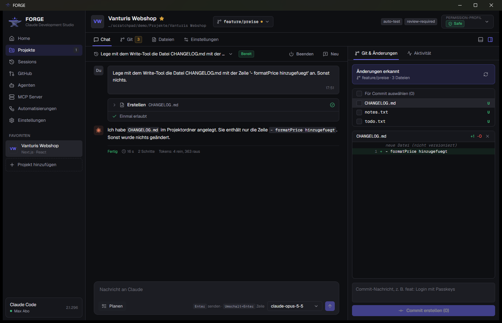
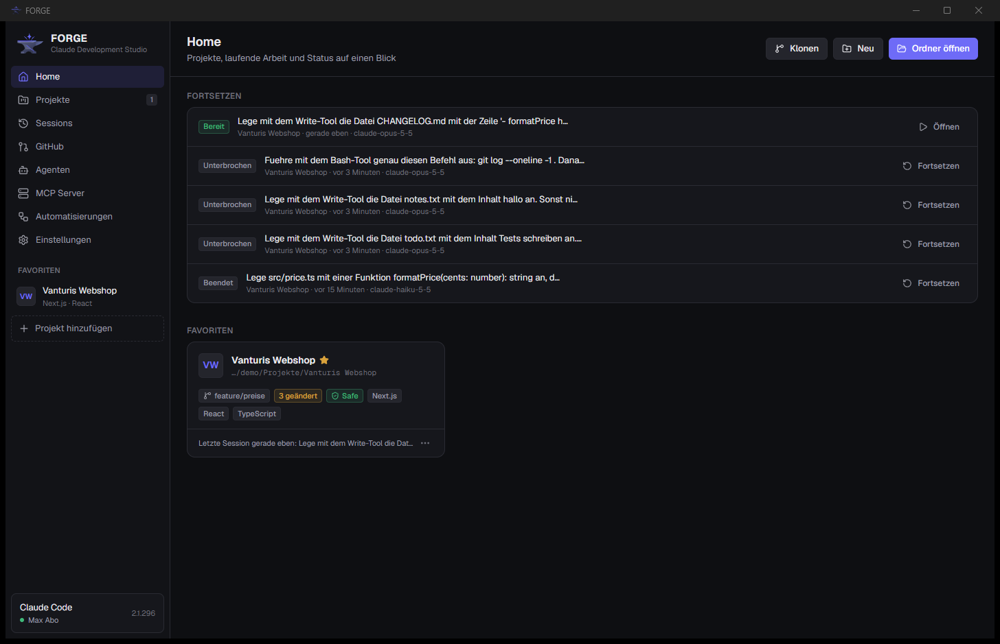
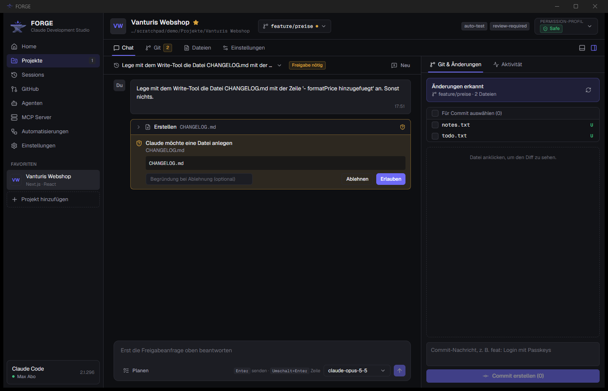

# FORGE – Claude Development Studio

Desktop-Oberfläche für Claude Code. FORGE startet und steuert echte Claude-Code-Sessions in deinen
Projekten, zeigt Antworten live, fragt Freigaben ab und bringt Git-Status, Diffs und geprüfte Commits in
dieselbe Ansicht. Die Anmeldung läuft über deine bestehende Claude-Code-Anmeldung (z. B. Max-Abo).
Ein API-Key ist nicht nötig.

> Stand: Phasen 0 bis 3 umgesetzt. Details zu Umfang und Lücken unten und in [HANDOFF.md](HANDOFF.md).



| Home | Freigabeanfrage im Safe-Profil |
|---|---|
|  |  |

## Installation

**Für Nutzer:** `FORGE_0.1.0_x64-setup.exe` ausführen. Mehr braucht es nicht: Node.js, Git (inkl. Bash)
und die GitHub CLI sind enthalten. Fehlt Claude Code, installiert FORGE es auf Knopfdruck über den
offiziellen Installer. Anmeldung bei Claude und GitHub erfolgt in der App (Einstellungen bzw. GitHub).

**Für die Entwicklung** (Windows 11 getestet, Linux ungetestet):

| Werkzeug | Version (getestet) |
|---|---|
| Node.js | ≥ 22.13 (getestet 24.14) |
| pnpm | 10.x |
| Rust + Cargo | stable (getestet 1.99, MSVC) |
| Windows: Visual Studio Build Tools | 2022, Workload „C++ Build Tools" |

```powershell
winget install Microsoft.VisualStudio.2022.BuildTools --override "--wait --passive --add Microsoft.VisualStudio.Workload.VCTools --includeRecommended"
winget install Rustlang.Rustup
```

Linux (Debian/Ubuntu) braucht zusätzlich die Tauri-Systempakete: `libwebkit2gtk-4.1-dev`, `build-essential`,
`libssl-dev`, `libayatana-appindicator3-dev`, `librsvg2-dev`; zur Laufzeit `nodejs` (≥ 22.13), `git`, `gh`.

## Claude-Max-Anmeldung

FORGE nutzt die **installierte Claude-Code-CLI** über den offiziellen Agent SDK
(`@anthropic-ai/claude-agent-sdk`, Option `pathToClaudeCodeExecutable`). Es gilt also genau die Anmeldung,
die du im Terminal benutzt:

```bash
claude auth status   # sollte "loggedIn": true und "subscriptionType": "max" zeigen
claude auth login    # falls nicht angemeldet, oder in FORGE: Einstellungen → Mit Claude-Konto anmelden
```

- FORGE liest keine Tokens und speichert keine Zugangsdaten.
- Ist `ANTHROPIC_API_KEY` gesetzt, würde Claude Code den Key statt des Abos nutzen. FORGE erkennt das,
  warnt und entfernt den Key standardmäßig aus der Session-Umgebung (abschaltbar unter Einstellungen).
- Pro Session zeigt FORGE die von der CLI gemeldete `apiKeySource` an. Im Test: `none` (Abo-Anmeldung).
- Laut Anthropic-Hilfeartikel „Use the Claude Agent SDK with your Claude plan" (Stand 07.10.2026) ist diese
  Nutzung mit Abo vorgesehen. Bedingungen können sich ändern; prüfe den Artikel bei Unsicherheit.
- `total_cost_usd` aus Claude Code ist bei Abo ein API-Äquivalent. FORGE zeigt deshalb keine Kosten an, nur
  Tokens und Dauer pro Durchlauf.

## Starten

```bash
pnpm install
pnpm dev          # baut den Sidecar und startet die Desktop-App (Tauri dev)
```

Weitere Befehle:

```bash
pnpm lint         # ESLint über alle Pakete
pnpm typecheck    # TypeScript strict für protocol, sidecar, desktop
pnpm test         # Unit- und Integrationstests (ohne echte Claude-Aufrufe)
pnpm test:e2e     # E2E mit echter Claude-Session (verbraucht etwas Abo-Kontingent, Modell haiku)
pnpm build        # Release inkl. Installer (lädt und prüft beim ersten Mal Node/Git/gh, ca. 140 MB)
pnpm prepare:runtime  # nur die mitgelieferte Laufzeit vorbereiten (für pnpm dev mit Bundle-Werkzeugen)
```

Umgebungsvariablen für Sonderfälle: `FORGE_NODE` (Pfad zu node), `FORGE_SIDECAR` (Pfad zu `sidecar.mjs`),
`FORGE_DATA_DIR` (Datenordner), `FORGE_E2E=0` (E2E überspringen), `FORGE_E2E_MODEL` (Modell für E2E).

## Was funktioniert

- **Projekte:** Ordner importieren (kanonisiert, Dubletten-Erkennung), neu anlegen (Ordner + git, optional GitHub-Repo), Repository klonen (nur https/ssh, sichere Argumente), Favoriten, Tags,
  Technologie-Erkennung, „Ordner fehlt"-Zustand. Entfernen nur aus FORGE oder auf Wunsch mit lokalem Ordner und GitHub-Repository.
- **Claude-Sessions:** starten, Prompt senden, echtes Token-Streaming, Tool-Aufrufe als aufklappbare
  Karten, Aufgabenlisten (TodoWrite), Freigabeanfragen mit Erlauben / Für Session erlauben / Ablehnen,
  Stop (Esc), Modell- und Effort-Wechsel (global, pro Projekt, pro Session), Plan-Modus, Resume auch nach App-Absturz, Übernahme von im Terminal
  gestarteten Sessions inkl. Verlauf.
- **Permission-Profile:** Safe / Balanced / Autonomous mit echter Wirkung auf den Claude-Permission-Modus,
  harte Sperrliste in allen Profilen, Audit-Log.
- **Git:** Status, echter Diff (auch für neue Dateien), Stage/Unstage, Commit nur der ausgewählten Dateien
  mit Review-Dialog und Secret-Prüfung, Verlauf, Branches anlegen und wechseln, git init.
- **Abo-Nutzung:** 5-Stunden- und Wochenfenster (auch pro Modell) unten links, mit Reset-Zeit.
- **GitHub:** Anmeldung in der App (Code anzeigen, Browser öffnet sich), Liste deiner Repositories mit Klonen per Klick.
- **Commit-Nachricht per KI:** Funken-Knopf im Commit-Feld; Claude (Haiku) schreibt die Nachricht aus dem Diff im Stil der bisherigen Commits. Sensible Dateien werden nicht gesendet.
- **Regeln für Claude:** CLAUDE.md global, pro Projekt und lokal (nicht im Git) direkt in FORGE bearbeiten.
- **Composer:** Bilder, PDFs und Textdateien anhängen (Knopf, Einfügen, Hineinziehen), Slash-Commands mit Auswahlliste, Dateien auf den Stand vor einer Nachricht zurücksetzen.
- **In der Claude-App weiterarbeiten:** Remote Control pro Projekt verbindet die FORGE-Sessions mit der Claude-App und claude.ai. Nachrichten erscheinen auf beiden Seiten, Freigaben und Sperrliste gelten weiter.
- **Terminal:** eingebettete Terminals im Projektordner.
- **Git & GitHub:** Push/Pull mit Schutzregeln, Pull Requests mit KI-Beschreibung und Status, neues Projekt direkt als GitHub-Repo.
- **Projekt-Tags mit Verhalten:** plan-first, auto-test, auto-commit, auto-push, review-required, no-network, sandbox-only.
- **Parallele Agenten:** Sessions in eigenen Git-Worktrees.
- **Erweiterungen:** MCP-Server, Skills, Subagenten und Hooks verwalten.
- **Wiedereinstieg:** KI-Zusammenfassung einer Session.
- **Rückfragen und Pläne:** Fragt Claude nach (AskUserQuestion), erscheinen die Optionen als Karte im Chat. Pläne aus dem Plan-Modus lassen sich annehmen oder mit Feedback zurückgeben.
- **Kontextanzeige:** Belegung des Kontextfensters am Composer, Komprimieren per Knopf (/compact).
- **Befehlspalette (Strg+K):** Projekte, Sessions, Aktionen und Volltextsuche über alle Verläufe.
- **Dev-Server:** Startbefehl pro Projekt (oder erkannt aus package.json), Adresse als Link, Ausgabe im unteren Panel, letzte Zeilen per Knopf an Claude.
- **Töne:** Signal, wenn Claude fertig ist, eine Freigabe braucht oder ein Fehler auftritt (abschaltbar).
- **Diagnose:** CLI-Version, Anmeldestatus, API-Key-Override, git, gh, Capability-Matrix.
- **Persistenz:** SQLite für Projekte, Sessions, Events, Freigaben, Einstellungen. Beim Start öffnet FORGE das zuletzt genutzte Projekt.

Tastatur: `Strg+1..4` Workspace-Tabs, `Strg+N` neue Session, `Strg+O` Projekt hinzufügen, `Strg+J` Claude-Output,
`Strg+Umschalt+E` Seitenleiste, `Esc` im Eingabefeld stoppt Claude.

## Tests

Letzter Lauf (Details in [docs/TESTING.md](docs/TESTING.md)): Lint und Typecheck ohne Befund, 107 Sidecar-Tests,
12 Desktop-Tests, 12 E2E-Tests mit echter Claude-Session, alle bestanden.

## Dokumentation

- [docs/ARCHITECTURE.md](docs/ARCHITECTURE.md): Prozesse, Module, Statusmaschine
- [docs/SECURITY.md](docs/SECURITY.md): Permission- und Sicherheitskonzept
- [docs/adr/](docs/adr): Architekturentscheidungen
- [THIRD_PARTY_LICENSES.md](THIRD_PARTY_LICENSES.md): mitgelieferte Software
- [docs/TASKS.md](docs/TASKS.md): Taskliste
- [HANDOFF.md](HANDOFF.md): aktueller Stand, bekannte Fehler, nächste Schritte

## Bekannte Lücken

- Linux nicht getestet (keine Linux-Umgebung verfügbar). Code ist plattformneutral geschrieben.
- Remote Control funktioniert nur, solange FORGE geöffnet ist. Die genutzte SDK-Funktion ist nicht offiziell dokumentiert.
- Claude Code selbst wird nicht mitgeliefert, sondern bei Bedarf aus der App installiert (offizieller Installer).

## Roadmap

- Linux-Build testen und als .deb/.AppImage ausliefern.
- Installer signieren (Windows SmartScreen), sobald ein Code-Signing-Zertifikat vorhanden ist.
- Merge-Hilfe für parallele Agenten (Konflikte gemeinsam mit Claude lösen).
