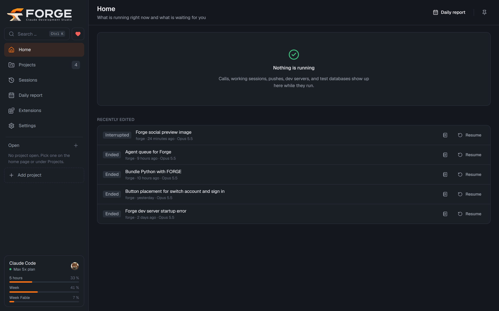
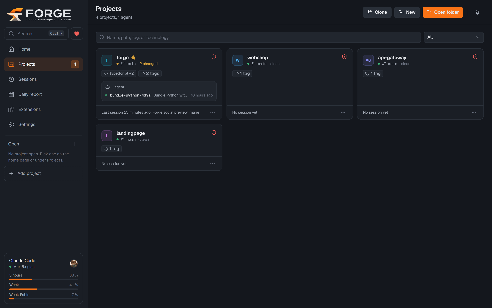

 English · <a href="README.de.md"> Deutsch</a>

<p align="center">
  
</p>

<p align="center">
  <a href="https://github.com/vanturis/forge/releases/latest"></a>
  <a href="https://github.com/vanturis/forge/releases/latest"></a>
  <a href="LICENSE.md"></a>
  
  <a href="https://forge.vanturis.de"></a>
</p>

<p align="center">
  <a href="https://github.com/vanturis/forge/releases/latest"></a>
  &nbsp;
  <a href="https://buy.stripe.com/9B64gBc4e5j80vg1WxbV600"></a>
</p>

<p align="center">
  <b>FORGE</b> runs real Claude Code sessions in your projects, streams the answers, asks for approvals<br>
  and puts Git, agents, preview and project knowledge into one window. With your own Claude subscription, no API key.
</p>

<table>
  <tr>
    <td width="50%"></td>
    <td width="50%"></td>
  </tr>
  <tr>
    <td align="center"><sub>Home: what is running, recent sessions, subscription usage</sub></td>
    <td align="center"><sub>Projects with Git status, technologies and running agents</sub></td>
  </tr>
</table>

<p align="center">
  <a href="#installation">Installation</a> ·
  <a href="#what-forge-does">Features</a> ·
  <a href="#privacy">Privacy</a> ·
  <a href="#support-forge">Support</a> ·
  <a href="#development">Development</a>
</p>

---

## What FORGE does

<table>
  <tr>
    <td width="50%" valign="top">
      <h3>Claude sessions</h3>
      Streaming, tool cards, approvals, plan mode and questions from Claude. Several sessions side by side in split view.
    </td>
    <td width="50%" valign="top">
      <h3>Parallel agents</h3>
      Each agent works in its own Git worktree on its own branch. If you want, FORGE merges finished work automatically.
    </td>
  </tr>
  <tr>
    <td valign="top">
      <h3>Git built in</h3>
      Diffs, commits of only the selected files, branches, push and pull, pull requests. Claude writes the commit messages.
    </td>
    <td valign="top">
      <h3>Preview and dev tools</h3>
      Dev server, local PostgreSQL test database and screenshots of the web app that Claude can look at itself.
    </td>
  </tr>
  <tr>
    <td valign="top">
      <h3>Safe by default</h3>
      Permission profiles (Safe, Balanced, Autonomous) and a blocklist that always blocks dangerous commands.
    </td>
    <td valign="top">
      <h3>Project knowledge</h3>
      Workflows, decisions and pitfalls that every session gets at start. FORGE detects outdated entries on its own.
    </td>
  </tr>
  <tr>
    <td valign="top">
      <h3>Subscription usage</h3>
      Usage in the 5-hour and weekly windows with a forecast, and a daily report with tokens, commits and agents.
    </td>
    <td valign="top">
      <h3>Phone and sync (optional)</h3>
      Call FORGE and control it by phone (SIP). Encrypted sync across several PCs through a private GitHub repository.
    </td>
  </tr>
</table>

## Installation

1. Download `FORGE_<Version>_x64-setup.exe` from the **[latest release](https://github.com/vanturis/forge/releases/latest)**.
2. Run it. The installer is not signed yet, so Windows shows a SmartScreen warning: click **More info** and then
   **Run anyway**.
3. On first start you pick the language. Then an assistant walks you through signing in to Claude and, if you
   want, to GitHub.

**Requirements:** Windows 10 or 11 (x64) and a Claude subscription with access to Claude Code, for example Pro
or Max. The installer includes Node.js, Git, the GitHub CLI and Python. If Claude Code is missing, FORGE installs
it on first start with the official installer from Anthropic.

**Language:** FORGE is available in English and German. You choose the language on first start and can change
it later in Settings.

<details>
<summary>Which file is the right one?</summary>

Not every release has an installer. "Latest" always points to the newest release that has one. Older installers
are named `FORGE_<Version>_<Runtime>_x64-setup.exe`. The files `FORGE_<Version>_update_<Runtime>.zip` are only
for updating existing installations and are not enough for a new installation. FORGE uses the file
`FORGE_<Version>.sig` itself to verify updates (releases up to 0.1.101 have a `.sig` per file and a `.runtime` file).
</details>

**Updates:** FORGE checks for them shortly after start and then every 30 minutes. You see the changes and install
with one click. Every update is signed, and FORGE verifies the signature before installing.

## Privacy

Projects, chat histories and settings stay on your computer (`%APPDATA%\forge`).

- **Anonymous usage statistics (off by default):** FORGE asks once on first start and asks you to turn them on.
  The totals show us how FORGE is used. Without an answer they stay off. When on, FORGE sends totals to
  [forge.vanturis.de](https://forge.vanturis.de) every 5 minutes: a random ID for the installation,
  the FORGE and Windows versions, the type of Claude subscription (for example Pro or Max 5x) and counters such
  as tokens per Claude model, estimated API cost, sessions, projects and agents. No content, no project names, no
  paths, no IP addresses. Turn them on or off under Settings > About FORGE > Privacy; when you turn them off,
  FORGE deletes the data already sent from the service.
- **Anthropic:** Claude Code sends your prompts and the project context to Anthropic with your own account.
  FORGE does not read any credentials.

<details>
<summary>All connections in detail</summary>

- **Installing and updating Claude Code:** If Claude Code is missing, FORGE downloads the official installer from
  `claude.ai`. To tell you about new versions, FORGE reads the version number from `downloads.claude.ai`.
- **Helper tasks:** Commit messages, session titles and the changelog in the update window also run through your
  Claude account.
- **Phone (optional, off by default):** Depending on the setting, call audio goes to Google (Gemini) or to
  OpenAI, each with your own API keys. The SIP connection goes to your phone system or SIP provider.
- **GitHub:** Updates and profile pictures in commits come from GitHub. Sync (optional) stores your FORGE data
  encrypted in a private repository of your GitHub account. All other GitHub features use your own account
  through the GitHub CLI.
- **npm registry:** The first time you start a test database in the dev tools, FORGE downloads PostgreSQL once
  as an npm package (`@embedded-postgres/windows-x64`) from `registry.npmjs.org`.
- **Usage statistics (only when turned on):** FORGE asks on first start, without an answer they stay off. To
  prevent abuse, the service keeps only a salted hash of the IP address in memory, for one day at most. The
  totals of all users are public at [forge.vanturis.de](https://forge.vanturis.de).

More in the [Vanturis privacy policy](https://vanturis.de/datenschutz) (German).
</details>

## Support FORGE

<a href="https://buy.stripe.com/9B64gBc4e5j80vg1WxbV600"></a>

If FORGE helps you, we appreciate a voluntary contribution. You choose the amount. The money goes to Vanturis UG
(haftungsbeschränkt), the company that develops FORGE. It is not a charity, so there is no donation receipt.

- **Suggestions and bugs:** [open an issue on GitHub](https://github.com/vanturis/forge/issues/new/choose),
  in English or German. For bugs, the FORGE version and the details from Settings > About FORGE > Diagnostics help.
- **Security vulnerabilities:** please do not report them as an issue. Follow [SECURITY.md](SECURITY.md) instead.
- **Contributing:** contributions are welcome, see [CONTRIBUTING.md](CONTRIBUTING.md).

## License

FORGE is an open source product of [Vanturis UG (haftungsbeschränkt)](https://vanturis.de), licensed under the
[GNU Affero General Public License, version 3](LICENSE.md) (AGPL-3.0-only).

- Use, modification and distribution are free, also for work and in companies.
- If you distribute a modified version or offer it as a service over a network, you must publish its source code
  under the AGPL.
- An additional permission under section 7 of the AGPL covers the combination with the Claude Agent SDK and
  Claude Code by Anthropic, see [NOTICE](NOTICE).
- A commercial license without the obligations of the AGPL is available from [Vanturis](https://vanturis.de).

Bundled third-party software and its licenses: [THIRD_PARTY_LICENSES.md](THIRD_PARTY_LICENSES.md) and
[THIRD_PARTY_NOTICES.md](THIRD_PARTY_NOTICES.md).

## Development

FORGE is a pnpm monorepo:

| Folder | Contents |
|---|---|
| `apps/desktop` | Tauri app (Rust) with a React interface |
| `packages/sidecar` | Node process that controls Claude Code, Git, phone and database |
| `packages/protocol` | shared types and RPC methods (Zod) |
| `services/stats` | statistics service behind forge.vanturis.de (Next.js, standalone) |

<details>
<summary>Tools and commands</summary>

| Tool | Version |
|---|---|
| Node.js | 22.13 or newer |
| pnpm | 10.x |
| Rust and Cargo | stable (MSVC) |
| Visual Studio Build Tools | 2022, workload "C++ Build Tools" |

```powershell
winget install Microsoft.VisualStudio.2022.BuildTools --override "--wait --passive --add Microsoft.VisualStudio.Workload.VCTools --includeRecommended"
winget install Rustlang.Rustup
```

```bash
pnpm install
pnpm dev              # builds the sidecar and starts the app (Tauri dev)
pnpm lint             # ESLint across all packages
pnpm typecheck        # TypeScript strict for protocol, sidecar and desktop
pnpm test             # unit and integration tests without real Claude calls
pnpm test:e2e         # E2E with a real Claude session (uses a little of your subscription quota)
pnpm build            # release with installer (downloads Node, Git, gh and Python the first time)
pnpm prepare:runtime  # only prepare the bundled runtime
pnpm notices          # regenerate THIRD_PARTY_NOTICES.md (after changing dependencies)
```

Environment variables for special cases: `FORGE_NODE` (path to node), `FORGE_SIDECAR` (path to `sidecar.mjs`),
`FORGE_DATA_DIR` (data folder), `FORGE_E2E=0` (skip E2E), `FORGE_E2E_MODEL` (model for E2E).

`.github/workflows/release.yml` builds a release on every push to `main`.
</details>

More documentation: [Architecture](docs/ARCHITECTURE.md) · [Security concept](docs/SECURITY.md) ·
[Tests](docs/TESTING.md) · [Architecture decisions](docs/adr) · project knowledge in `.forge/knowledge/`

---

<p align="center">
  <sub>A product of <a href="https://vanturis.de">Vanturis UG (haftungsbeschränkt)</a> · <a href="https://vanturis.de/impressum">Imprint</a> · <a href="https://vanturis.de/datenschutz">Privacy policy</a></sub>
</p>
